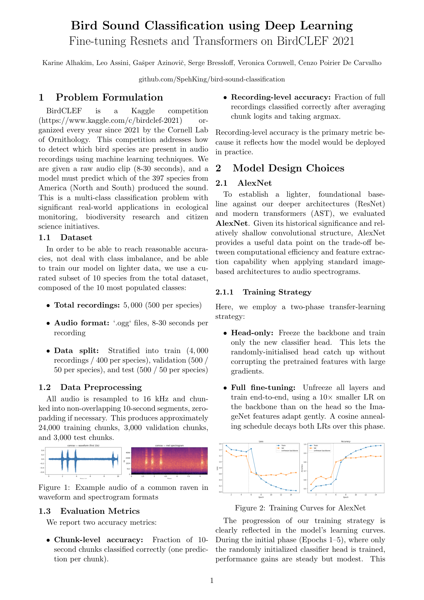
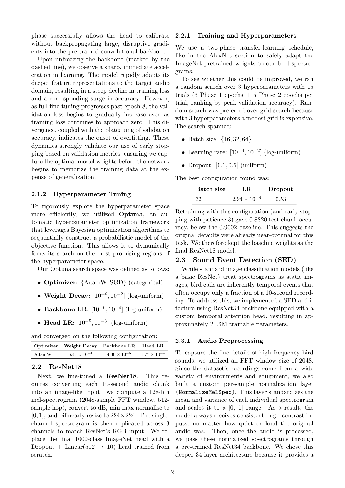
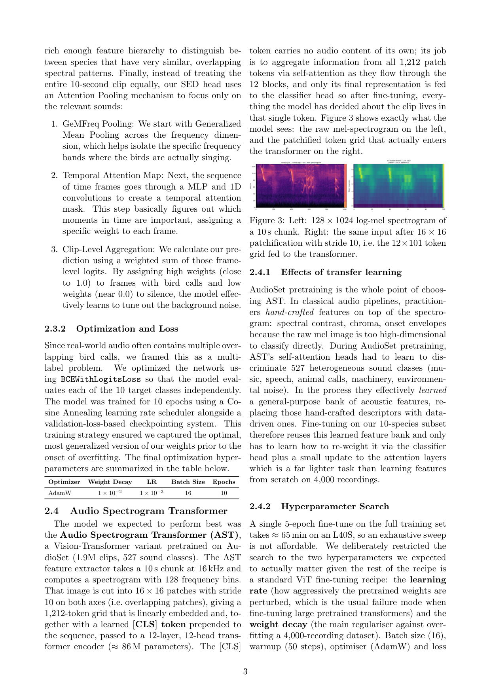
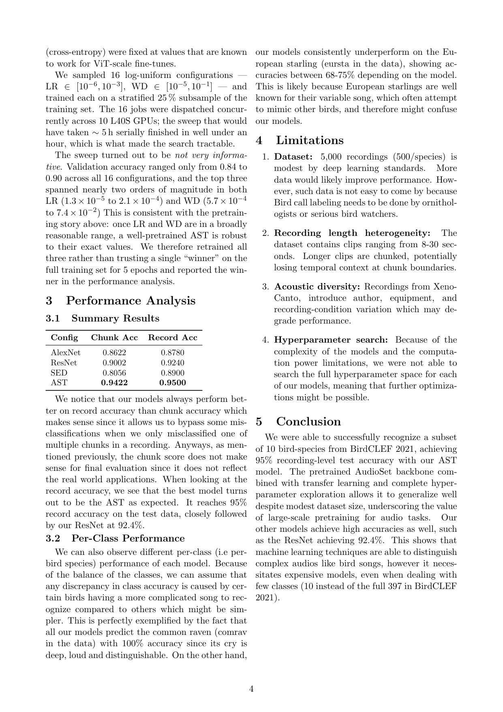

# Bird Sound Classification using Deep Learning

Fine-tuning ResNets and Transformers on BirdCLEF 2021.

Course project for _Practical Deep Learning_ — we benchmark four architectures (AlexNet, ResNet18, an SED head on ResNet34, and the Audio Spectrogram Transformer) on a 10-species subset of the [BirdCLEF 2021](https://www.kaggle.com/c/birdclef-2021) dataset and study the effect of large-scale audio pretraining.

**Authors:** Karine Alhakim, Leo Assini, Gašper Azinovič, Serge Bressloff, Veronica Cornwell, Cenzo Poirier De Carvalho.

## Full report

The full write-up — methodology, hyperparameter search, per-class analysis, limitations — is rendered inline below. For the searchable/selectable version, open **[📄 Practical_DL_Project.pdf](Practical_DL_Project.pdf)**.

<details>
<summary><b>📖 Read the report (4 pages)</b></summary>






</details>

## Results

Test accuracy on the 10-species test split (500 recordings):

| Model    | Recording Acc |
| -------- | ------------: |
| AlexNet  |        0.8780 |
| ResNet18 |        0.9240 |
| SED      |        0.8900 |
| **AST**  |    **0.9500** |

Recording-level accuracy (majority vote over 10 s chunks) reflects how the model would be used in practice. The AudioSet-pretrained AST wins clearly; its large-scale audio pretraining transfers well despite a modest 4,000-recording training set.

## Dataset

10 acoustically diverse species from BirdCLEF 2021, 500 recordings each (5,000 total, ~4.4 GB of `.ogg` audio). Stratified 400 / 50 / 50 train / val / test split per species.

See [`data/README.md`](data/README.md) for species list, split CSV schema, and loading code.

Preprocessing: resample to 16 kHz, chunk into non-overlapping 10 s segments (zero-pad tail), convert to 128-bin mel-spectrogram. Produces ~24k train / 3k val / 3k test chunks.

## Repository layout

```
kaggle_comp/
├── Practical_DL_Project.pdf    # Full report
├── code/                       # Training scripts (.py)
│   ├── alexnet/train.py
│   ├── resnet18/
│   │   ├── train.py            # Two-phase (head-only → full fine-tune)
│   │   └── hyperparam_tune.py  # Optuna search
│   ├── sed/train.py            # ResNet34 backbone + temporal attention head
│   ├── transformers/
│   │   ├── train.py            # AST fine-tuning
│   │   └── hyperparam_finetune.py
│   ├── data.py                 # Dataset / dataloader utilities
│   └── evaluate.py             # Chunk- and recording-level metrics
└── data/
    ├── README.md
    ├── splits_10birds.csv
    └── short_audio_10/         # (not tracked) audio files
```
